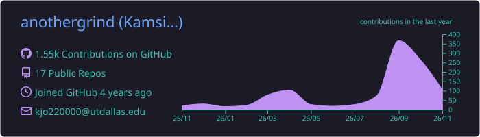
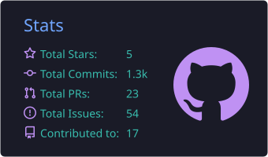
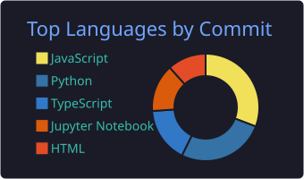

## About Me

I'm Kamsi, a Computer Science undergraduate at **UT Dallas** (graduating May 2027). I do quantum software engineering research, and I'm interested in quantum computing, software engineering, and machine learning. I'm currently looking for **Summer 2027 internships** and graduate research opportunities.

## Experience

**Undergraduate Researcher, Quantum Software Engineering** · *UT Dallas*
- Developing mutation testing techniques for quantum circuits as part of a quantum program bug benchmark (private until publication)

**AI/ML Fellow** · *Break Through Tech*
- **AI Studio:** worked with **Swytch** on a team machine learning project (see pinned repo)

**Software Engineering Intern** · *Atlassian*

## Tech Stack

  

**Libraries:** Qiskit · scikit-learn · pandas · NumPy · React

## GitHub Stats

  

  
  

  

